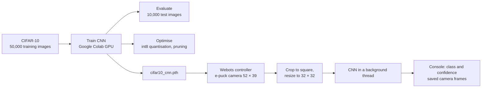

# CNN Object Classification for an E-puck Robot in Webots

[](https://colab.research.google.com/github/sakthi7sg/epuck-webots-cnn-object-detection/blob/main/cnn/cifar10_cnn.ipynb)


A convolutional neural network (CNN) is trained on CIFAR-10 **off the robot**, then used by a simulated **e-puck** in Webots to classify what its camera sees. The project also measures how quantisation, pruning and a lower inference rate let the CNN run without disturbing the robot's movement.

> Applied Robotics and AI Project, Part 2, BEng (Hons) Robotics and Artificial Intelligence, University of Hertfordshire.

### ▶ Run the notebook in Google Colab

<a href="https://colab.research.google.com/github/sakthi7sg/epuck-webots-cnn-object-detection/blob/main/cnn/cifar10_cnn.ipynb"></a>

**Link:** [https://colab.research.google.com/github/sakthi7sg/epuck-webots-cnn-object-detection/blob/main/cnn/cifar10_cnn.ipynb](https://colab.research.google.com/github/sakthi7sg/epuck-webots-cnn-object-detection/blob/main/cnn/cifar10_cnn.ipynb)

---

## Contents

- [Objectives](#objectives)
- [Repository structure](#repository-structure)
- [Pipeline](#pipeline)
- [CNN architecture](#cnn-architecture)
- [Quick start](#quick-start)
- [Optimisation for the robot](#optimisation-for-the-robot)
- [Requirements](#requirements)

---

## Objectives

| # | Objective | Where |
|---|---|---|
| 1 | Build a CNN for CIFAR-10 and show all its layers | Notebook, section 3 |
| 2 | Report the test accuracy and compare it with published models | Notebook, section 5 |
| 3 | Predict three images: a cat photo, a car photo and an e-puck camera image from Webots | Notebook, section 6, images in `cnn/test_images/` |
| 4 | Place objects in Webots and classify an image from the e-puck camera | `cnn_camera_classifier` controller, notebook section 6 |
| 5 | Optimise the model so the robot's operation is not affected | Notebook, section 7, and the controller |
| 6 | Demonstrate Webots detecting coloured objects | `Assignment_2` controller |

---

## Repository structure

```text
epuck-webots-cnn-object-detection/
├── cnn/
│   ├── cifar10_cnn.ipynb            # training, evaluation, three-image predictions, optimisation
│   ├── test_images/                 # cat.jpg, car.jpg and the Webots camera frame (sources in SOURCES.md)
│   └── requirements.txt
├── controllers/
│   ├── cnn_camera_classifier/
│   │   ├── cnn_camera_classifier.py # e-puck turns on the spot and classifies camera frames
│   │   ├── cnn_model.py             # CNN definition shared with the notebook
│   │   └── requirements.txt
│   └── Assignment_2/
│       └── Assignment_2.py          # coloured-block search used for the colour detection demo
├── worlds/
│   ├── cnn_camera_test.wbt          # e-puck surrounded by a dog, a cat, a horse and a deer
│   └── Assignment_2.wbt             # arena with red, blue and green blocks
└── README.md
```

---

## Pipeline



Training needs far more computation than a small robot has, so it runs on a GPU in Google Colab. The trained weights are copied to the robot, which only runs the much cheaper forward pass.

---

## CNN architecture

A VGG-style network with three convolution blocks (about 0.81 M parameters). The definition is in [`cnn_model.py`](controllers/cnn_camera_classifier/cnn_model.py) and is shared by the notebook and the controller.

| Stage | Layers | Output |
|---|---|---|
| Input | RGB image, normalised with the CIFAR-10 mean and standard deviation | 3 × 32 × 32 |
| Block 1 | 2 × (Conv 3×3, 32 filters → BatchNorm → ReLU) → MaxPool 2×2 → Dropout 0.2 | 32 × 16 × 16 |
| Block 2 | 2 × (Conv 3×3, 64 filters → BatchNorm → ReLU) → MaxPool 2×2 → Dropout 0.3 | 64 × 8 × 8 |
| Block 3 | 2 × (Conv 3×3, 128 filters → BatchNorm → ReLU) → MaxPool 2×2 → Dropout 0.4 | 128 × 4 × 4 |
| Classifier | Flatten → Linear 2048→256 → BatchNorm → ReLU → Dropout 0.5 → Linear 256→10 | 10 class scores |

**Training:** SGD with Nesterov momentum 0.9, one-cycle learning rate (peak 0.1), weight decay 5 × 10⁻⁴, label smoothing 0.1, 30 epochs, batch size 128, random crop and horizontal flip augmentation.

---

## Quick start

### 1. Train the CNN in Google Colab

1. Open the notebook in Colab: [cnn/cifar10_cnn.ipynb](https://colab.research.google.com/github/sakthi7sg/epuck-webots-cnn-object-detection/blob/main/cnn/cifar10_cnn.ipynb).
2. Choose **Runtime → Change runtime type → T4 GPU**.
3. Choose **Runtime → Run all**. Training takes about 10 minutes.
4. Section 6 downloads the test images from `cnn/test_images/` automatically (a cat, a car and the Webots camera frame), so nothing needs to be uploaded.
5. Download `cifar10_cnn.pth` and `cnn_outputs.zip` (figures and `results.json`) at the end.

### 2. Classify the e-puck camera image in Webots

1. Install PyTorch in the Python that Webots uses (**Tools → Preferences → Python command**):
   ```bash
   pip install torch
   ```
2. Copy `cifar10_cnn.pth` into `controllers/cnn_camera_classifier/`.
3. Open `worlds/cnn_camera_test.wbt` in Webots and press **Run**.
4. The e-puck turns on the spot. The console shows lines such as:
   ```text
   [  12.3 s] I think this is a dog (78%) | 2.4 ms | frame camera_frame_0006.png
   [CNN] 40 frames | mean 2.6 ms per frame | 0.5% of the time between frames
   ```
5. The classified frames are saved in `controllers/cnn_camera_classifier/frames/`. Copy the clearest one to `cnn/test_images/webots_camera.png` and run notebook section 6 again.

If the model file or PyTorch is missing, the controller prints what to do and keeps the robot running.

### 3. Colour detection demo

Open `worlds/Assignment_2.wbt` and press **Run**. The e-puck searches the arena and prints `I see red`, `I see blue` or `I see green` the first time it reaches each block, followed by a summary of the colours found so far.

---

## Optimisation for the robot

The e-puck controller updates its motors every **64 ms**. If a classification blocks the loop for longer than that, the robot's movement suffers. The controller uses four measures:

| Measure | How | Effect |
|---|---|---|
| Background thread | The CNN runs in a `ThreadPoolExecutor`; the control loop only collects finished results | Motor commands are never delayed by the CNN |
| Lower inference rate | One frame every 8 control steps (about 0.5 s) | CPU load divided by 8 |
| Single CPU thread | `torch.set_num_threads(1)` | Matches a small robot computer and leaves the other cores free |
| Static int8 quantisation | Set `USE_INT8 = True` | About 4× smaller and about 2× faster on the CPU |

The notebook compares FP32, dynamic int8, static int8 and 50% pruning on test accuracy, model size, time per image and frames per second.

---

## Requirements

| Component | Version |
|---|---|
| [Webots](https://cyberbotics.com/) | R2023b |
| Python | 3.10 or later |
| PyTorch | 2.0 or later (training and the Webots controller) |
| Notebook extras | torchvision, torchinfo, scikit-learn, matplotlib (already in Colab except torchinfo, which the notebook installs) |

### E-puck devices used

| Device | Webots name | Use |
|---|---|---|
| Colour camera | `camera` | 52 × 39 pixel frames for the CNN and the colour detection |
| Wheel motors | `left wheel motor`, `right wheel motor` | Velocity control, ±6.28 rad/s |
| Proximity sensors | `ps0` to `ps7` | Obstacle avoidance in the colour search |

---

## Author

**Sakthi** · [@sakthi7sg](https://github.com/sakthi7sg)
